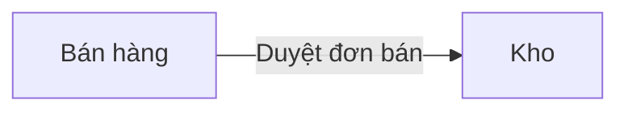

# Liên kết giữa các module

> Dữ liệu chảy giữa các module: chứng từ / trạng thái ở module này làm thay đổi dữ liệu ở module khác.

## Sơ đồ tổng thể

## Bảng sự kiện liên module

| # | Sự kiện nguồn (module · chứng từ · trạng thái) | Tác động (module đích · dữ liệu thay đổi) | Thời điểm | Đồng bộ / bất đồng bộ | Nếu lỗi | BR | FR |
|---|---|---|---|---|---|---|---|

## Dữ liệu dùng chung

| Dữ liệu (ENT) | Module sở hữu (tạo / sửa) | Module chỉ đọc |
|---|---|---|
